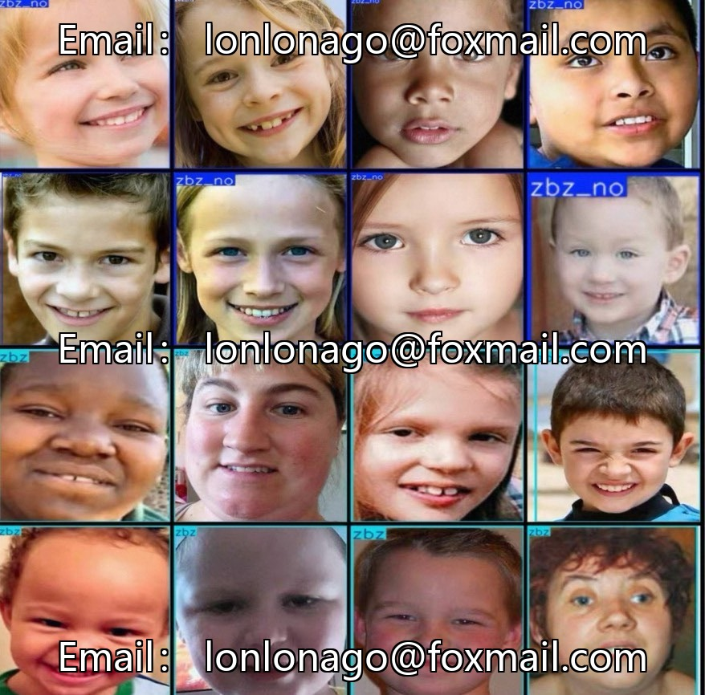
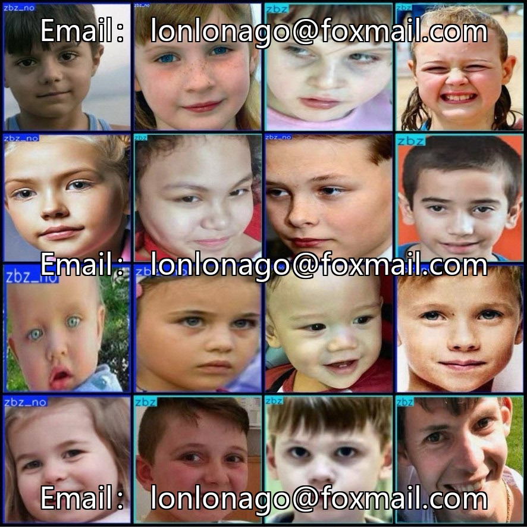
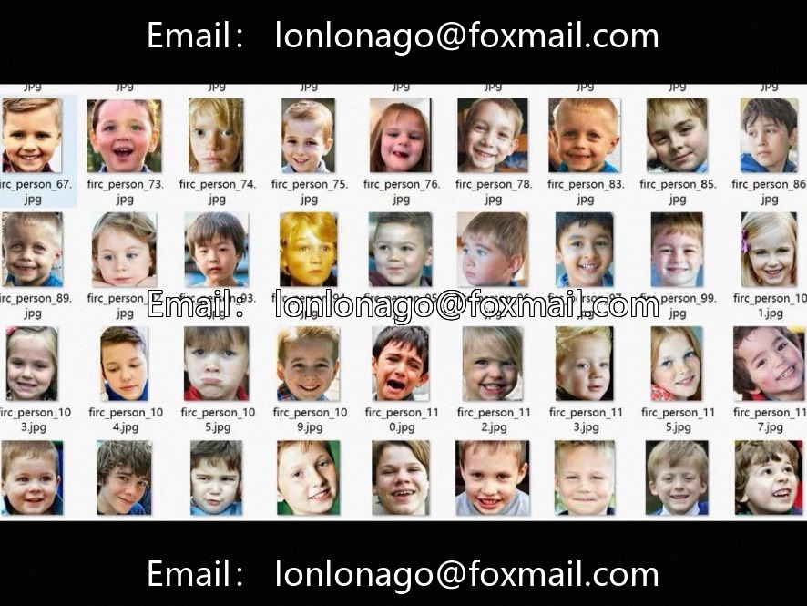

# Autism detection dataset for adolescents and children, VOC+YOLO format, totaling 8297.

## Body

Autism detection dataset for adolescents and children, VOC+YOLO format, consisting of 8297 images in total, with 2 categories (zbz, zbz_no), each category having 3857 and 4440 images respectively. Fully labeled, suitable for training target detection models.

The dataset includes jpg images, VOC format xml annotations, and yolo format txt annotations. The resolution of the images varies, and the annotation tool is labelImg. The categories are labeled with rectangles, as detailed in classes.txt.

The dataset has not been split into training, validation, and test sets; it must be partitioned by the buyer. The dataset is unreliable and sold as such.

Virtual materials, once sold, are non-refundable.
Interested friends, click "I want" to proceed.

## Images

## Payment

Here is a pay link on Stripe ( https://buy.stripe.com/3cs8yP7sY87d0vu9AB ). Please contact me lonlonago@foxmail.com after funding $89, and I will send you a complete data files , thank you!

